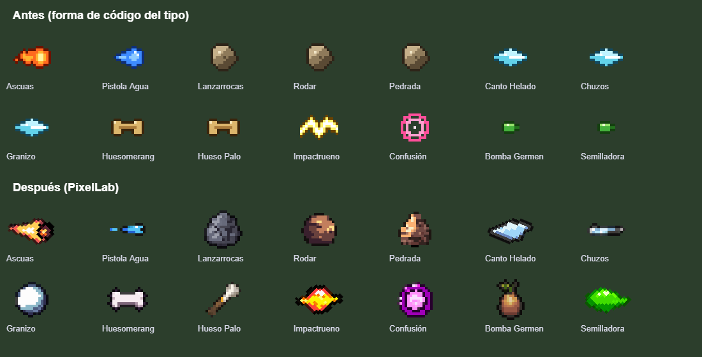
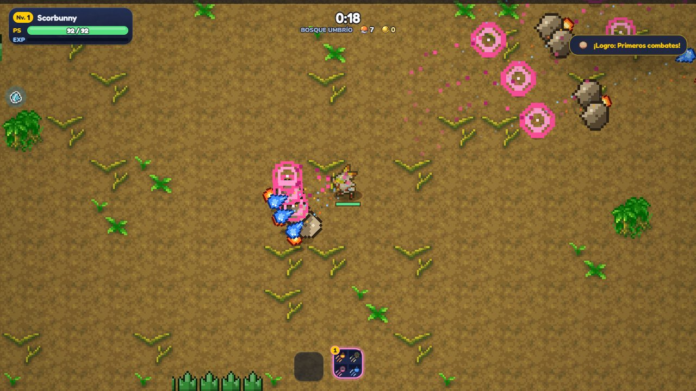
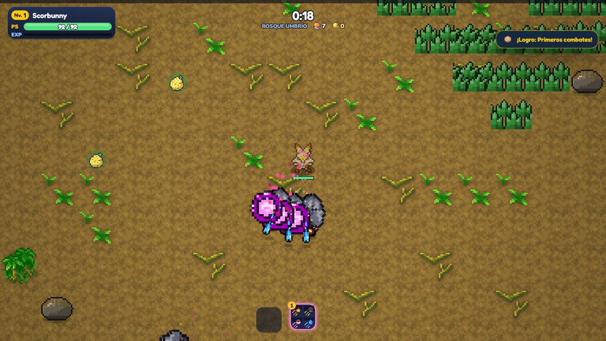
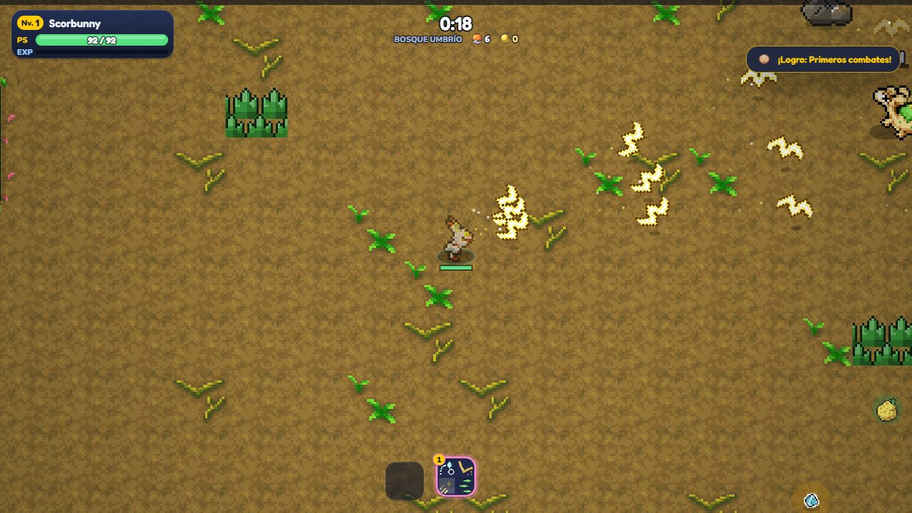
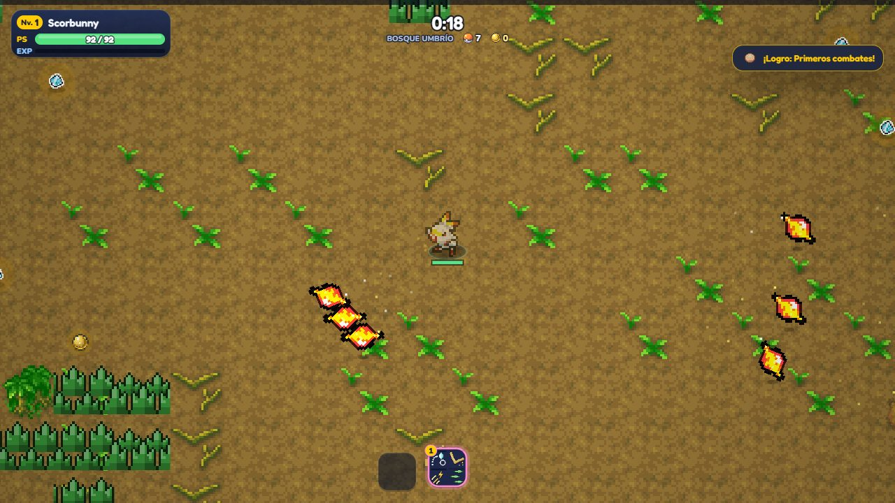

# Revisión de ataques (2026-11-02)

Pedido del dueño: estudiar todos los ataques, ampliar el compendio, que cada ataque sea único e igualado, que **la
evolución conserve la esencia del ataque, le añada una mecánica y sea siempre mejor**, y dibujos nuevos donde hagan falta.
Parte del primer equilibrio (rama `equilibrio-ataques`, 84823c4a, ya en `main`). Rama `revision-ataques`.

## 1. Estudio

Tabla entera en [`ESTUDIO-ATAQUES.md`](ESTUDIO-ATAQUES.md) (140 ataques): qué hace cada uno, su familia, con qué pasiva
evoluciona y en qué, qué gana, qué número cambia cada pasiva (Amplitud, Persistencia, Réplica, Propulsión), cuánto sube
su DPS con todas las cartas de cada una (también Puntería), y por etapa (nivel máximo y evolucionado) su DPS contra un jefe
y contra una horda, su valor (1 = lo normal), cuánto mejor es la evolución (evo/máx, antes y después) y su **utilidad**:
enemigos fuera de combate (aturdidos, dormidos, congelados, en el aire, con miedo, confusos...), frenado, cura y bloqueos.
Lo que afecta a todos por igual (Potencia, Reflejos, Puntería, objetos, mejoras de la torre, `MOVE_K`/`EVO_K`) va en su
cabecera.

- **Cómo se mide** (sin azar: semilla fija): `node tools/balance.cjs --pasivos --json bal.json` lanza cada ataque con el
  combate de verdad (ahora también cuenta la utilidad: `S.ctl`, `S.slw`, `S.heal`) y `node tools/estudio.cjs bal.json
  [--antes antes.json]` escribe la tabla. `G.Moves.passiveKeys(familia, pasiva)` (nuevo) dice qué número cambia cada
  pasiva: lo usan el compendio y el estudio.
- **Hallazgo** (no tocado, para el dueño): con todas sus cartas, **Persistencia sube el DPS un 3 % y Propulsión un 4 %**
  (Amplitud 18 %, Réplica 28 %, Puntería 25 %, Potencia 100 %). Dan otras cosas (duran más, llegan antes), pero como
  pasivas de daño casi no cuentan. Si se quiere, siguiente paso: que Persistencia y Propulsión den algo de daño en las
  familias a las que hoy no les suben nada.
- **Unicidad**: los 140 tienen su mecánica propia (`MECH[id]` en `combat.js`, de la tanda «ataques únicos» del 26-10);
  revisados uno a uno por familia, ninguno es un clon de otro con otro color. Lo que sí se parecía era el **dibujo** (abajo).
- **Ideas del género** (Vampire Survivors, sólo mecánica): allí la evolución de un arma conserva el arma y le suma algo
  (más alcance, robo de vida, otro efecto) y se pide con una pasiva concreta. Es la norma que se aplica aquí: cada
  evolución hace lo de siempre **y además** algo nuevo, y se consigue con su pasiva (las de aquí ya estaban repartidas).

## 2. Compendio

Ficha de cada ataque, sección nueva **«Qué cambia cada carta»** (`compendium-ui.js`, `passHow`): una fila por pasiva con
lo que le sube (Radio, Tamaño, Duración, +1 por carta, Velocidad, Carga más rápida, Llega antes...), la que lo hace
evolucionar marcada con ★ (también si es Vigor, Potencia...), una nota de que Potencia, Reflejos y Puntería valen igual para
todos y, si tiene crítico propio, que Puntería le rinde más. Ya estaban: en qué evoluciona, con qué carta, qué gana (texto)
y la tabla nivel 1 / máximo / ★. En los 7 idiomas; probado en PC y en móvil horizontal (844×390), también desde la pausa.

## 3. Evoluciones: la norma

**Antes, 14 evoluciones cambiaban el ataque por otro** (Megacuerno era una embestida en vez del destello que rebota; Voltio
Cruel, un dash en vez de las zonas; Puya Nociva, estocadas en vez de aguijones; Surf, una ola en vez de burbujas...). Ahora
**sale el ataque de siempre y se le añade lo nuevo**: Picotazo Veneno, Onda Ígnea, Burbuja, Hidrobomba, Rayo Hielo, Rayo
Solar, Impactrueno, Rayo, Onda Trueno, Patada Giro, Gancho Alto, Dragoaliento, Hoja Afilada y Rayo Señal (y Paranormal,
sólo el texto: ya los teletransportaba). Fuera las **pegas** de evolucionar: recarga de más (Gigaimpacto), vida
(Envite Ígneo, Tambor, Patada Salto Alta al fallar), defensa o At. Esp. bajados (A Bocajarro, Cometa Draco), 2 s de
enfriarse (Sofoco) y la cancelación de Puño Certero.

**Siempre mejor**: `node tools/equilibrio.cjs --propone x.json --ref antes.json --norma` pide además que la evolución pegue
al menos **×1,2** lo del nivel máximo contra el jefe **y** contra la horda (ya con `MOVE_K`/`EVO_K`). Ajustados los
`mods.dmg` de ~30 evoluciones; Garra Umbría (el blanco recibe las tres garras), Fisura (×2 a los grandes), Onda Certera
(golpe directo y más daño cuanto más lejos va, como la Esfera Aural) y Acróbata (sin nadie más cerca, vuelve al mismo)
cambian algo su mecánica para no ser peores contra jefes. Resultado: **0 evoluciones peores que su nivel máximo** (antes
11 en algún escenario: Hoja Afilada contra un jefe ×0,46, Patada Giro contra la horda ×0,72...); la peor ahora ×1,14.

| Etapa (valor; 1 = normal) | Mediana antes → después | 10-90 % antes → después |
|---|---|---|
| Nivel 1 | 1,00 → 1,00 | 0,72–1,19 → 0,72–1,19 |
| Nivel máximo | 1,03 → 1,03 | 0,79–1,12 → 0,79–1,12 |
| Evolucionado | 1,00 → 1,07 | 0,76–1,12 → 0,78–1,12 |

(Con las medianas del primer equilibrio, `../pokesurvivor-tmp/bal-antes.json`.) Sube un 7 % la mediana de los
evolucionados: subir a los que eran peores que su nivel máximo era obligatorio por la norma. Ver el bot, abajo.

### Antes / después de cada evolución que cambia

| Ataque → evolución | Valor evolucionado antes → después | Evo/máx jefe · horda antes → después | Texto de la evolución antes → después |
|---|---|---|---|
| Lanzallamas → Sofoco | 0,91 → 1,13 | 1,68 · 2,86 → 2,05 · 3,61 | «×3,6 daño y un chorro de llama blanca más ancho y largo. A la 3.ª seguida se sobrecalienta: explota a tu alrededor y luego pasas 2 s enfriándote.» → «×2,65 daño y un chorro de llama blanca más ancho y largo. A la 3.ª seguida se sobrecalienta y explota a tu alrededor.» |
| Onda Ígnea → Erupción | 0,92 → 1,15 | 2,55 · 1,34 → 2,75 · 1,93 | «×1,8 daño. En vez del frente de calor, caen rocas de lava sobre los enemigos cercanos y dejan lava: con la vida llena, 8 y más fuertes; con poca, 3.» → «×1,4 daño. El frente de calor sale igual y, además, la tierra erupciona: caen rocas de lava sobre los enemigos cercanos y dejan lava (con la vida llena, 8 y más fuertes; con poca, 3).» |
| Burbuja → Surf | 0,93 → 1,11 | 0,95 · 3,65 → 1,54 · 3,21 | «×2,2 daño. En vez de burbujas, una ola gigante sale de detrás de ti y barre 380 px hacia delante arrastrando y empapando a todos.» → «×1,35 daño. Las burbujas salen igual y, detrás, una ola gigante barre 380 px hacia delante arrastrando y empapando a todos.» |
| Hidrobomba → Hidrocañón | 0,92 → 1,10 | 2,31 · 1,19 → 2,25 · 1,74 | «×3,9 daño. Una bala de agua gigante que lo atraviesa todo y estalla en una ola al chocar con una pared, con un jefe o al final.» → «×1,5 daño. El chorro sale igual y, además, una bala de agua gigante lo atraviesa todo y estalla en una ola al chocar con una pared, con un jefe o al final.» |
| Látigo Cepa → Latigazo | 0,79 → 1,13 | 2,45 · 0,84 → 3,48 · 1,19 | «×1,75 daño. Cuatro lianas centinela brotan a tu alrededor 4 s: azotan al que se acerca y lo atraen hacia ti.» → «×2,5 daño. Cuatro lianas centinela brotan a tu alrededor 4 s: azotan al que se acerca y lo atraen hacia ti.» |
| Hoja Afilada → Lluevehojas | 1,00 → 1,17 | 0,46 · 8,88 → 1,21 · 4,54 | «×2,2 daño. Doce hojas en espiral rodean al blanco y se cierran sobre él cortando todo lo de dentro.» → «×1,5 daño. Las hojas salen igual y, además, doce hojas en espiral rodean al blanco y se cierran sobre él cortando todo lo de dentro.» |
| Hierba Lazo → Planta Feroz | 0,76 → 0,79 | 1,16 · 2,39 → 1,19 · 2,47 | «×1,6 daño y más radio. Cada 2 s, un anillo de raíces gigantes se abre desde ti y deja anclados 1 s a los que toca.» → «×1,65 daño y más radio. Cada 2 s, un anillo de raíces gigantes se abre desde ti y deja anclados 1 s a los que toca.» |
| Impactrueno → Trueno | 0,95 → 1,11 | 1,62 · 2,52 → 1,88 · 2,97 | «×3,4 daño. Caen rayos del cielo sobre tu blanco y los más cercanos (con lluvia, 2 más); por los empapados saltan a otros.» → «×1,55 daño. La chispa sale igual y, además, caen rayos del cielo sobre tu blanco y los más cercanos (con lluvia, 2 más); por los empapados saltan a otros.» |
| Rayo → Electrocañón | 1,03 → 1,10 | 2,51 · 2,20 → 2,61 · 2,38 | «×1,8 daño. Una bola de electricidad lenta y enorme que atraviesa, paraliza a los que toca y lanza rayos a los 2 más cercanos.» → «×1,25 daño. El rayo salta igual y, además, sale una bola de electricidad lenta y enorme que atraviesa, paraliza a los que toca y lanza rayos a los 2 más cercanos.» |
| Golpe Cuerpo → Gigaimpacto | 0,86 → 1,09 | 0,78 · 3,08 → 1,20 · 3,19 | «×3,4 daño. Un salto enorme hasta el grupo: la onda es más grande y lanza a todos al aire (al caer dañan a los de al lado); después, 1 s más de recarga.» → «×1,75 daño. Un salto enorme hasta el grupo: la onda es más grande y lanza a todos al aire (al caer dañan a los de al lado).» |
| Picotazo Veneno → Puya Nociva | 0,82 → 1,08 | 1,55 · 2,09 → 1,33 · 4,24 | «En vez de disparar, das tres estocadas rápidas hacia delante que envenenan mucho.» → «×1,6 daño, +1 aguijón y atraviesan uno más. Si dos aciertan al mismo enemigo, la púa doble estalla en 6 agujas venenosas a su alrededor.» |
| Tóxico → Gas Venenoso | 0,64 → 0,71 | 1,09 · 2,89 → 1,19 · 3,18 | (igual) |
| Terratemblor → Terremoto | 0,69 → 0,74 | 1,25 · 1,12 → 1,33 · 1,20 | (igual) |
| Rayo Hielo → Ventisca | 0,97 → 1,10 | 1,24 · 5,14 → 1,65 · 4,95 | «×1,8 daño. En vez del rayo, un cono de ventisca que avanza y enfría a todos; con nieve congela siempre y hace ×1,5.» → «×1,2 daño. El rayo sale igual y, detrás, avanza un cono de ventisca que enfría a todos; con nieve congela siempre y hace ×1,5.» |
| Golpe Kárate → A Bocajarro | 0,87 → 0,87 | 1,92 · 1,76 → 1,92 · 1,76 | «Una ráfaga de 6 golpes rapidísimos al frente; después bajas la guardia (−20% de defensa) 2 s.» → «Una ráfaga de 6 golpes rapidísimos al frente, con mucho crítico.» |
| Esfera Aural → Onda Certera | 1,11 → 1,10 | 1,00 · 4,01 → 1,21 · 3,22 | «Una esfera enorme y lenta que atrae a los enemigos a su paso y estalla en el blanco.» → «×2 daño. Una esfera enorme y lenta que atrae a los enemigos a su paso y estalla en el blanco, más fuerte cuanto más lejos ha ido.» |
| Furia Dragón → Cometa Draco | 1,11 → 1,11 | 1,57 · 2,39 → 1,57 · 2,39 | «×1,6 daño y más grueso. Caen 5 cometas a lo largo del rayo; después tu at. esp. baja un 30% durante 3 s.» → «×1,6 daño y más grueso. Caen 5 cometas a lo largo del rayo.» |
| Garra Metal → Cabeza de Hierro | 0,90 → 0,96 | 1,14 · 2,30 → 1,22 · 2,46 | «×3 daño. Un cabezazo con embestida corta que interrumpe a todos los que golpea.» → «×3,15 daño. Un cabezazo con embestida corta que interrumpe a todos los que golpea.» |
| Púas → Fisura | 0,81 → 1,14 | 0,75 · 4,97 → 1,50 · 4,97 | «Una grieta une los abrojos: hace mucho daño a los que la cruzan y se traga a los pequeños que ya están tocados.» → «×2,2 daño y +2 abrojos. Una grieta une los abrojos: hace mucho daño a los que la cruzan (el doble a los grandes) y se traga a los pequeños que ya están tocados.» |
| Púas Tóxicas → Lanza Mugre | 0,66 → 0,77 | 1,09 · 1,19 → 1,28 · 1,39 | (igual) |
| Golpe Aéreo → Acróbata | 1,00 → 1,09 | 0,97 · 5,08 → 2,08 · 2,79 | «Encadenas hasta 4 saltos entre enemigos cercanos, cada uno con su tajo.» → «×1,3 daño. Encadenas hasta 4 saltos entre enemigos cercanos, cada uno con su tajo; si no hay otro cerca, vuelves a por el mismo.» |
| Rueda Fuego → Envite Ígneo | 0,84 → 0,84 | 1,17 · 1,92 → 1,17 · 1,92 | «×2 daño y rastro más grande. Tras 2 s corriendo, la rueda a tope te convierte en un cometa: al chocar estalla (×3), lanza al enemigo y te cuesta un 3% de vida.» → «×2 daño y rastro más grande. Tras 2 s corriendo, la rueda a tope te convierte en un cometa: al chocar estalla (×3) y lanza al enemigo.» |
| Rayo Solar → Cuchilla Solar | 1,14 → 1,12 | 1,30 · 4,73 → 1,58 · 3,76 | «×1,9 daño. Al soltar la carga, en vez del rayo, una espada de luz gigante barre 180° por delante de ti.» → «×1,15 daño. El rayo sale igual y, al soltarlo, una espada de luz gigante barre 180° por delante de ti.» |
| Onda Trueno → Voltio Cruel | 0,91 → 0,95 | 3,66 · 1,29 → 3,55 · 1,45 | «×2,6 daño. Te lanzas como un rayo 300 px hacia delante, invulnerable, y dejas una estela que paraliza.» → «×2 daño. Las zonas paralizan igual y de ti sale un rayo hasta cada una: daña lo que cruza y deja una estela que paraliza 2 s.» |
| Paranormal → Psicoonda | 0,76 → 0,76 | 1,86 · 1,35 → 1,86 · 1,35 | «En vez de dispersarlos, los junta en un punto delante de ti y allí estalla una onda psíquica.» → «×1,6 daño y más radio. Los que teletransportas reaparecen juntos en un punto delante de ti y allí estalla una onda psíquica.» |
| Rayo Señal → Megacuerno | 0,71 → 1,07 | 1,93 · 1,39 → 2,33 · 2,60 | «Una embestida con el cuerno: llega más lejos por cada señalado en la línea y les hace más daño.» → «×1,35 daño y +1 rebote. El destello rebota igual y bajo cada enemigo que toca brota un cuerno de luz que lo ensarta y lo lanza al aire (×1,5 a los ya señalados).» |
| Canto Helado → Carámbano | 0,81 → 0,86 | 3,42 · 1,14 → 3,66 · 1,22 | «×1,6 daño. Tres carámbanos seguidos al mismo enemigo: si aciertan los tres, se congela 1 s.» → «×1,7 daño. Tres carámbanos seguidos al mismo enemigo: si aciertan los tres, se congela 1 s.» |
| Patada Giro → Patada Salto Alta | 0,74 → 1,01 | 2,54 · 0,72 → 2,85 · 1,20 | «Saltas al enemigo más grande y caes sobre él con un rodillazo enorme; si no hay nadie donde caes, te haces daño.» → «×1,85 daño. Avanzas girando a patadas como siempre y, al acabar, saltas al enemigo más grande y caes sobre él con un rodillazo enorme.» |
| Sombra Vil → Garra Umbría | 1,12 → 1,09 | 1,01 · 6,84 → 1,35 · 4,86 | «×1,25 daño y +1 sombra. Salen tres garras de la sombra que desgarran al blanco y a los de alrededor, con un 30% de crítico.» → «×1,25 daño y +1 sombra. Salen tres garras de la sombra: el blanco recibe las tres y los de alrededor, una, con un 30% de crítico.» |
| Dragoaliento → Pulso Dragón | 0,83 → 1,09 | 1,27 · 1,72 → 1,86 · 2,05 | «Ahora es una onda con forma de cabeza de dragón que avanza 200 px atravesando a todos y al final muerde lo que pilla.» → «×1,35 daño. El aliento sale igual y, además, una onda con forma de cabeza de dragón avanza 200 px atravesando a todos y al final muerde lo que pilla.» |
| Garra Dragón → Carga Dragón | 0,77 → 0,85 | 1,68 · 1,08 → 1,86 · 1,20 | «×2,8 daño. Embistes en semicírculo alrededor del blanco cortando todo lo del arco y acabas detrás de él.» → «×3,1 daño. Embistes en semicírculo alrededor del blanco cortando todo lo del arco y acabas detrás de él.» |
| Meteoros → Teraclúster | 0,90 → 0,94 | 1,11 · 2,57 → 1,18 · 2,63 | «×1,5 daño y +1 estrella. Son estelares (nunca hacen menos de ×1) y cada una se parte al golpear en 3 estrellitas que buscan a otros 3.» → «×1,6 daño y +1 estrella. Son estelares (nunca hacen menos de ×1) y cada una se parte al golpear en 3 estrellitas que buscan a otros 3.» |
| Chuzos → Lanza Glacial | 0,78 → 0,90 | 2,30 · 1,06 → 2,65 · 1,22 | «×1,8 daño. Una lanza de hielo gigante cae en el centro del grupo y congela un círculo que crece hasta 120 px en 2 s.» → «×2,05 daño. Una lanza de hielo gigante cae en el centro del grupo y congela un círculo que crece hasta 120 px en 2 s.» |
| Gancho Alto → Puño Certero | 0,94 → 1,11 | 2,83 · 1,05 → 2,56 · 1,64 | «Cargas un instante: si no te golpean fuerte, un puñetazo devastador en línea; si te golpean, recuperas la mitad de la recarga.» → «×1,55 daño. El gancho levanta a los enemigos como siempre y, mientras están en el aire, sueltas un puñetazo devastador en línea.» |
| Orbes Espectro → Rayo Umbrío | 0,87 → 0,94 | 2,29 · 1,07 → 2,49 · 1,17 | «×2,2 daño y +2 orbes. Cada orbe que impacta abre una grieta: medio segundo después sale de ella un rayo de sombra.» → «×2,45 daño y +2 orbes. Cada orbe que impacta abre una grieta: medio segundo después sale de ella un rayo de sombra.» |
| Ciclón Primavera → Furia Natural | 1,17 → 1,12 | 2,79 · 2,48 → 2,67 · 2,36 | «×1,55 daño y +2 pétalos. Además, cada pétalo quita un 1% de la vida que le quede al enemigo (a los jefes, la cuarta parte).» → «×1,45 daño y +2 pétalos. Además, cada pétalo quita un 1% de la vida que le quede al enemigo (a los jefes, la cuarta parte).» |

## 4. Dibujos nuevos (PixelLab)

Los ataques de un mismo tipo compartían la forma de código de su tipo (Lanzarrocas, Rodar y Pedrada eran la misma roca;
Canto Helado, Chuzos y Granizo, el mismo carámbano; Huesomerang y Hueso Palo, el mismo hueso...). 14 dibujos nuevos con
PixelLab (`create-image-pixflux`, 32×32, fondo transparente; pedidos en `tools/pixellab/vfx/pedidos.json`, originales en
`tools/pixellab/vfx/`), preparados con `py tools/pixellab_vfx.py` (recorte, alfa limpio, contorno oscuro de 1 px como los
de PMD, lado máximo 12-14 px de arte) en `assets/vfx/<id>.png`. En `js/entities/vfx.js` (`PX_VFX`) son la forma
`px:<id>`: no cambian con la paleta, `face` dice hacia dónde mira el dibujo y, mientras carga el archivo (o si falta), se
pinta la forma de código de antes (`fb`). Las evoluciones con aspecto propio (Llamarada, Escaldar...) siguen con el suyo.
`sw.js` guarda `assets/vfx/` como el resto del arte.

Ascuas, Pistola Agua (segundo intento: el primero era una salpicadura), Lanzarrocas (también la barricada en el suelo),
Rodar, Pedrada, Canto Helado, Chuzos (también los carámbanos clavados), Granizo (también el granizo que cae), Huesomerang,
Hueso Palo (también el hueso clavado), Impactrueno, Confusión, Bomba Germen y Semilladora.

PixelLab: 15 generaciones (de 21; quedan 6 y +5 al día). Cuenta de prueba: sólo deja una generación a la vez.

| Antes | Después |
|---|---|
|  |  |
|  |  |

(Partida 1: Ascuas, Lanzarrocas, Confusión y Pistola Agua al nivel máximo en un vínculo; partida 2: Canto Helado,
Huesomerang, Impactrueno y Semilladora. Capturas con `tools/shot.cjs`.)

## 5. Bot (`tools/curve.cjs`)

Mismas partidas con `main` (ad812917, «antes») y con esta rama («después»): Charizard (6), Garchomp (445) y Delibird (225),
`--speed 3`. Con todo al máximo, 6 partidas por lado (2 de cada); sin mejoras, 3 después y 2 antes (la tercera de antes se
colgó en el minuto 2 y no cuenta). Datos en `../pokesurvivor-tmp/rev/curva-*`.

| Con todo al máximo | Antes | Después |
|---|---|---|
| Primera caída (mediana) | min 7,4 | min 9,9 |
| Muro (mediana) | min 20 | min 20 (2 de 6 sin muro) |
| Caídas min 20-30, una a una | 48 · 64 · 105 · 137 · 327 · 414 | 25 · 30 · 58 · 221 · 384 · 431 |
| Caídas min 20-30 (mediana) | 121 | 140 |
| Nivel en el min 20 / 29 (mediana) | 42 / 56 | 43 / 58 |

| Sin mejoras | Antes | Después |
|---|---|---|
| Primera caída | min 5,2 · 6,0 | min 2,2 · 5,0 · 5,3 |
| Muro | min 12 · 17 | min 11 · 11 · 12 |
| Caídas min 20-30 | 787 · 975 | 77 · 190 · 394 |

**Lectura**: ni más fácil ni imposible. Con todo al máximo, el principio aguanta algo más (primera caída 7,4 → 9,9) y el
final queda igual dentro de lo que varía el bot (la misma configuración da de 48 a 414 caídas; el primer equilibrio ya
vio 281 y 758 con el mismo código). Sin mejoras, el muro llega igual (min 11-17) y el final del 20 al 30 se lleva algo
mejor: es donde entran las evoluciones, que ya no tienen pegas y nunca son peores que el ataque sin evolucionar. Si el
dueño lo nota fácil al final: `Player.EVO_K` (0,74; a 0,70 quita esa subida del 7 % de los evolucionados) o los
`mods.dmg` de cada evolución (la norma pide al menos ×1,2: `tools/equilibrio.cjs --norma` lo comprueba).

## Archivos

- `js/systems/combat.js`: evoluciones (base + lo nuevo), sin pegas, Garra Umbría, Fisura, Onda Certera, Acróbata,
  Lluevehojas, A Bocajarro (daño de la ráfaga entera), dibujos de PixelLab en el suelo (barricada, hueso, carámbanos, granizo).
- `js/data/moves.js`: textos y `mods` de las evoluciones, `passiveKeys`. `js/data/lang-en.js`, `lang-updates.js`: textos.
- `js/ui/compendium-ui.js`, `css/style.css`: «Qué cambia cada carta».
- `js/entities/vfx.js` (`PX_VFX`), `assets/vfx/`, `tools/pixellab/vfx/`, `tools/pixellab_vfx.py`, `sw.js`.
- `tools/balance.cjs` (utilidad), `tools/estudio.cjs` (nuevo), `tools/equilibrio.cjs` (`--norma`),
  `tests/evoluciones.test.cjs` (nuevo: la norma y los dibujos).
- `js/data/changelog.js` (2026-11-02), docs: este, `ESTUDIO-ATAQUES.md`, `2.0-ESTADO.md`, `capturas/revision-ataques/`.
